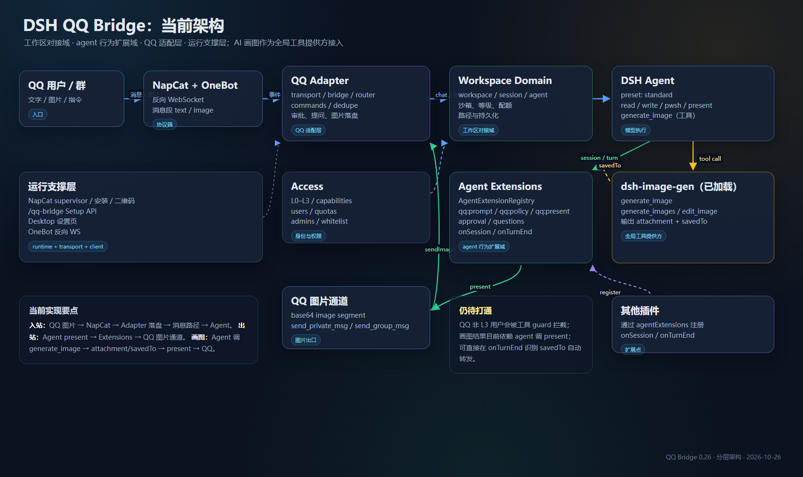

# 架构



QQ Bridge 分为 **两个业务域 + 一个运行支撑层**。依赖方向是单向的：

```text
QQ / NapCat / OneBot
        │
        ▼
src/transport/                 OneBot 反向 WS、去重
        │
        ▼
src/qq/                        QQ 适配层：Bridge、ConversationRouter、命令
        │
        ├──────────────► src/workspace/   工作区、会话、agent 生命周期
        │
        ├──────────────► src/agent-ext/   agent 行为扩展
        │
        ├──────────────► src/access/      等级、能力、配额
        │
        └──────────────► src/runtime/     NapCat 进程、安装、控制 API
                               │
                               ▼
                        src/core/  配置、路径、存储、凭据
```

## 目录

```text
src/
  index.js                  Cordis 入口 / composition root
  core/                     无业务知识的基础设施
    config.js
    paths.js
    store.js
    secrets.js
    credentials.js
    selftest.js
  access/                   身份与权限
    levels.js
    capabilities.js
    users.js
  transport/                OneBot 与 Fake 传输
    onebot.js
    fake.js
    dedupe.js
  workspace/                工作区对接域
    chat.js                 工作区/会话/agent 生命周期
    reply.js                回复提取与分段
  agent-ext/                agent 行为扩展域
    registry.js             扩展注册表（Cordis 服务 agentExtensions）
    builtins.js             QQ 内置扩展：prompt/visual-design/policy/present
    approval.js             审批转 QQ
    questions.js            ask_user_question 转 QQ
    images.js               入站图片落盘
    screenshot.js           全屏截图
    present.js              present 图片自动转发
    generated-images.js     image-gen 结果按 savedTo 自动转发
    session-images.js       按会话归档图片（sessions/<sessionId>/）
    policy.js               审批策略 + 工具 guard
    prompts/                所有系统提示词（*.prompt.js）
      qq-images.prompt.js   QQ 图片发送约定
      visual-design.prompt.js 视觉设计协作规则
      index.js              提示词统一出口
  qq/                       QQ 适配层
    bridge.js               组合根：用户、审批、问答、命令、聊天
    router.js               sessionId ↔ chat 索引
    commands.js             指令适配器
  runtime/                  运行支撑
    napcat.js               NapCat 进程守护
    napcat-install.js       下载/解压 NapCat
    napcat-http.js          Desktop 控制 API
    browse.js               目录选择
```

## 领域职责

### workspace：工作区对接域

负责“QQ 聊天 → 工作区 → 会话 → agent”的稳定映射：

- 用户/群目录、默认工作区、群工作区；
- 工作区创建、切换、重命名、删除；
- 会话创建、恢复、切换、归档；
- agent preset、provider、沙箱模式；
- 工作区/会话持久化。

**不负责**：审批弹窗、提问、图片发送、QQ 系统提示。

行为通过构造参数注入，而不是 import：

```js
behavior = {
  sessionReady(context) {},
  turnEnd(context) {},
}
```

`workspace/` 不 import `agent-ext/`；由 `qq/bridge.js` 负责装配。

## agent 扩展注册表

`index.js` 把 `AgentExtensionRegistry` 暴露为 Cordis 服务：

```js
const registry = ctx.get('agentExtensions')
const dispose = registry.register({
  name: 'my-plugin',
  onSession({ agent, session, chat, state, level, sendText, sendImage, log }) {},
  onTurnEnd({ chat, session, fromSeq, sendImage, sendText, state, log }) {},
})
```

- 多个扩展按注册顺序执行；
- 单个扩展抛错只记录日志，不影响其他扩展；
- `register()` 返回 disposer；
- QQ 的 prompt / visual-design / policy / present 只是四个内置扩展：

```text
qq:prompt        → agent-ext/prompts/qq-images.prompt.js
qq:visual-design → agent-ext/prompts/visual-design.prompt.js
qq:policy        → agent-ext/policy.js
qq:present  → agent-ext/present.js
```

因此其他渠道插件可以注册自己的提示词、审批策略、turn 结束行为，而不需要改
`workspace/` 或 `qq/`。

### agent-ext：agent 行为扩展域

负责在 agent 生命周期上挂 QQ 行为：

- 工具审批 → QQ 文本，回 `1/2`；
- `ask_user_question` → QQ 文本，回序号/文字；
- 本轮 `deliverables/presented` 中的图片 → QQ；
- `/screenshot`、`/sendimage` 的媒体输出；
- 入站图片保存；
- QQ 专用系统提示；
- 非 L3 的工具 guard 与审批策略。

**不负责**：创建工作区、恢复会话、决定用户等级。

### qq：QQ 适配层

- `bridge.js` 是 composition root，把 transport、users、approval、questions、
  commands、workspace manager 接起来；
- `router.js` 是 sessionId ↔ chat 的唯一索引，供审批/提问/媒体使用；
- `commands.js` 是 QQ 指令适配器，指令是入口，不是领域逻辑。

### runtime：运行支撑

- NapCat 进程启停、二维码、下载安装；
- Desktop 设置页调用的 `/qq-bridge/*` HTTP API；
- 目录选择。

它不依赖 workspace/agent-ext，只被 `index.js` 组合。

## 工具提供方：dsh-image-gen

AI 画图不是 QQ Bridge 的一部分，而是 DSH 的全局工具提供方：

```text
dsh-image-gen
  → ctx.tools.register(generate_image / generate_images / edit_image)
  → 输出 attachment + savedTo
```

QQ agent 的 `preset: standard` 能看到这些全局工具，因此生成不需要本插件注册新工具。
输出回传由 `qq:generated-images` 处理：

- 读取本轮 `tool/result` 的 `meta.savedTo`，覆盖 `generate_image`、`generate_images`、`edit_image`；
- 每张图同时归档到 `<workspace>/dsh-image-gen/sessions/<sessionId>/`，原 `savedTo` 仍供
  `edit_image` 使用；
- agent 若也调用了 `present`，`qq:present` 会发送，`qq:generated-images` 按路径去重，不会重复发图；
- 生成提示词与引擎方言交给 `image-gen` skill，QQ agent 在生图前按需加载。

QQ 非 L3 用户需要管理员授予 `image` 能力，才能使用
`generate_image` / `edit_image` / `present` / `skill` 等工具；L3 默认可全用。

## 关键依赖规则

1. `workspace/` 不 import `qq/`；
2. `agent-ext/` 不 import `qq/`、`runtime/`；
3. `transport/` 不 import `workspace/`、`agent-ext/`（仅媒体段解析常量可放宽）；
4. `runtime/` 不 import `workspace/`、`agent-ext/`；
5. 只有 `qq/bridge.js` 和 `index.js` 知道所有域；
6. 域之间通过构造参数/回调传递能力，不通过全局单例互相查找。

## 主要运行链路

### 消息 → agent

```text
OneBot event
  → transport.normalizeEvent
  → qq.bridge.handleMessage
  → users.level/capabilities
  → commands.execute（若是指令）
  → agent-ext.images.saveIncomingImage（若有图）
  → workspace.chat.handle
      → ensure workspace/session
      → agent.followup
      → whenIdle
      → agent-ext.present.forwardPresentedImages
```

### 审批/提问

```text
DSH approval/request
  → agent-ext.approval
  → qq.router.chatForSession(sessionId)
  → transport.sendText
  → 用户回 1/2 或选项
```

### 截图

```text
用户 /screenshot
  → qq.commands
  → agent-ext.screenshot.captureScreen
  → transport.sendImage(base64)
```

## 扩展点

- **新增 agent 行为**：注册一个 `agentExtensions` 扩展，不需要改 workspace；
- **新增工作区能力**：只改 `workspace/` + `qq/commands.js`；
- **换 QQ 协议**：新增 `transport/` 实现，workspace/agent-ext 不变；
- **换部署方式**：只改 `runtime/` 与 `index.js`。

## 已知边界

- `commands.js` 仍是一个 QQ 适配器文件，包含 workspace/admin/agent 三类指令；
  领域逻辑已经下沉，后续可再拆成 `qq/commands/*`；
- `workspace/chat.js` 仍负责 agent 创建与沙箱，因为它们是工作区会话生命周期的一部分；
- 审批/提问的“谁能回答”仍由 QQ 聊天身份决定，这是产品约束，不是领域泄漏。
