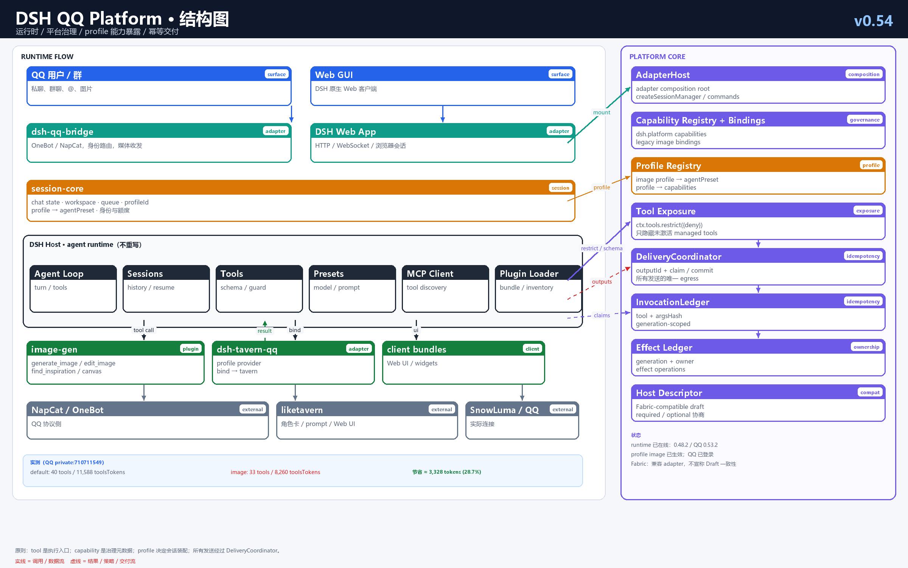

# 架构



完整执行链见 [execution-flow.md](execution-flow.md) 与 [execution-flow-v0.55.png](execution-flow-v0.55.png)；
当前版本、运行态与测试基线见 [current-state.md](current-state.md)。

## 1. 三层四包

```text
QQ / NapCat / OneBot
        │
        ▼
dsh-qq-bridge（本仓库）        沟通适配器：传输、身份、命令、媒体出口
        │ adapter host
        ├──────────────► @dsh/platform-core   治理：profile、capability→tool、
        │                                     交付/调用台账、generation、Fabric
        └──────────────► @dsh/session-core    会话：workspace、队列、state、沙箱
```

| 包 | 位置 | 职责 |
|---|---|---|
| `dsh-qq-bridge` | 本仓库 | QQ ↔ DSH 的适配器，实现 `{ id, mount(host) }` |
| `@dsh/platform-core` | `E:\dsh\dsh-platform-core` | profile 解析、能力注册、工具暴露、交付/调用幂等、统计与预测、Fabric 兼容 |
| `@dsh/session-core` | `E:\dsh\dsh-session-core` | 会话生命周期、工作区、queue、`profileId`、`accessGrants`、沙箱模式 |
| `dsh-image-gen` | 第三方插件 | 全局生图/改图工具，结果通过 `meta.savedTo` 交给平台交付 |

依赖方向单向：**适配器依赖核心，核心不依赖 QQ**。核心包不含 OneBot、NapCat、群号、QQ 号等概念。

## 2. 依赖规则

1. `src/qq/` 可以依赖 host context，不直接 `import` 平台/会话核心实现。
2. `src/agent-ext/` 不 import `src/qq/`、`src/runtime/`。
3. `src/transport/` 不 import `src/qq/`、`src/agent-ext/`。
4. `src/runtime/` 不 import `src/qq/`、`src/agent-ext/`。
5. `src/core/` 没有业务知识，只做配置、路径、存储、凭据。
6. 只有 `src/index.js` 和 `src/qq/bridge.js` 知道所有域。
7. 域之间通过构造参数/回调传递能力，不通过全局单例互相查找。

## 3. 本仓库目录

```text
src/
  index.js                Cordis 入口 / composition root：配置、adapterHost 装配、
                          NapCat 守护、/qq-bridge/* 设置接口、自检
  core/
    config.js             默认值与校验（agent、limits、sandbox、napcat、transport…）
    home.js               DSH_HOME 解析
    secrets.js            API Key 文件读取（env 优先）
    credentials.js        写入 DSH 凭据存储
    store.js              state.json 原子读写
    civitai-account.js    Civitai 账户总额查询（/admin image-balance）
    selftest.js           四接缝自检
  transport/
    onebot.js             OneBot 11 反向 WS：握手、token、action 关联、事件规范化
    dedupe.js             message_id 去重（TTL + 容量）
    fake.js               离线/测试传输
  qq/
    bridge.js             适配器组合根：users、approval、questions、commands、chat
    router.js             sessionId ↔ chat 唯一索引
    commands.js           QQ 指令适配器（workspace / admin / agent 三类）
    command-registry.js   插件可注册命令（`ctx.qqCommands`）
    identity.js           身份辅助
  agent-ext/
    registry.js           agent 扩展注册表（`agentExtensions` 服务）
    builtins.js           QQ 内置扩展：prompt / policy / present
    approval.js           工具审批 → QQ 文本，回 1/2
    questions.js          ask_user_question → QQ 文本
    images.js             入站图片落盘（get_image 回退）
    present.js            present 图片自动转发
    session-images.js     按会话归档图片
    screenshot.js         /screenshot 全屏截图
    policy.js             审批策略 + 工具 guard（含生图额度闸门）
    prompts/              QQ 专用提示词
  runtime/
    napcat.js             NapCat 进程守护
    napcat-install.js     下载/解压 NapCat
    napcat-http.js        Desktop 控制与状态 API
    browse.js             目录选择
```

## 4. QQ 适配层

`src/index.js` 只做组装：

```js
const bridge = adapterHost.mount({ id: 'qq', mount(host) { ... } }, { config, root })
```

host context 由 platform-core 提供（见 [adapter-contract.md](adapter-contract.md)）：

```text
host = {
  id, config, root, log,
  extensions,                 // 共享 AgentExtensionRegistry
  registerExtensions(list),   // 注册适配器自有扩展
  createSessionManager(opts), // 核心拥有的 ChatAgentManager
  createUserStore(opts),      // 核心拥有的 UserStore
  forwardMediaOutputs(opts),  // 表面无关的媒体交付
  resolveWorkspacesRoot(dir),
  access,                     // toolAllowed 等辅助
}
```

`src/qq/bridge.js` 是适配器组合根：把 transport、users、approval、questions、
commands、chat manager 接起来，并向 `ctx` 提供 `qqCommands`。

## 5. agent 行为扩展

`index.js` 把 `AgentExtensionRegistry` 暴露为 Cordis 服务：

```js
const registry = ctx.get('agentExtensions')
const dispose = registry.register({
  name: 'my-plugin',
  onSession({ agent, session, chat, state, level, sendText, sendImage, log }) {},
  onTurnEnd({ chat, session, fromSeq, sendImage, sendText, state, log }) {},
})
```

- 多扩展按注册顺序执行，单个扩展抛错只记录日志；
- `register()` 返回 disposer；
- QQ 的 prompt / policy / present 只是内置扩展：

```text
qq:group            → agent-ext/prompts/group.prompt.js
qq:prompt           → agent-ext/prompts/qq-images.prompt.js
qq:policy           → agent-ext/policy.js
qq:present          → agent-ext/present.js
qq:generated-images → host.forwardMediaOutputs（生图结果按 savedTo 回传、归档、扣额度）
```

因此其他渠道插件可以注册自己的提示词、审批策略、turn 结束行为，而不改会话层。

## 6. 主链路

### 消息 → agent

```text
OneBot event
  → transport.normalizeEvent
  → qq.bridge.handleMessage（先做 message_id 去重）
  → users.level / accessGrants
  → commands.execute（若是指令）
  → approval.tryAnswer / questions.tryAnswer（回 1/2 或选项时在这里接管）
  → agent-ext.images.saveIncomingImages（若有图，追加 [图片已保存] 路径）
  → chat.handle(message, { level, accessGrants, imageQuota, requester, principal })
      → session-core：ensure workspace/session、队列、followup、whenIdle
```

### 审批 / 提问

```text
DSH approval/request → agent-ext.approval → qq.router.chatForSession
                     → transport.sendText → 用户回 1/2
ask_user_question    → agent-ext.questions → 同一路径，回序号或文字
```

### 媒体

```text
入站：QQ 图片 → 下载到 attachments/incoming → 消息里追加 [图片已保存] 路径

出站：
  present 展示的图片        → qq:present → sendImage
  image-gen 结果（meta.savedTo）→ qq:generated-images → 平台 forwardMediaOutputs
                                → DeliveryCoordinator 去重 → sendImage
```

## 7. profile → capability → tool

- 会话层只保存用户显式选择的 `profileId`，不预测默认（见 [profile-resolution.md](profile-resolution.md)）；
- platform-core 在 `agent/created` 单点解析 effective profile：selected > predicted > 无；
- `sessionReady` 时按 effective profile 调用 `applyToolExposure`：
  只 deny 未激活 capability 绑定的 managed tool，保留 base tools；
- preset-scope 工具无法用 `restrict` 隐藏时，由 `agent-ext/policy.js` 的 guard 在执行前拒绝；
- profile 的 `promptPolicy` / `toolPolicy` 决定平台提示词与工具面（见 [tool-exposure.md](tool-exposure.md)）。

## 8. 幂等、交付与 generation

```text
DeliveryCoordinator   同 session/turn/surface/outputId 只交付一次
InvocationLedger      同 session/turn/tool/args 只执行一次
capability mutex      同能力只允许一个 provider
profile policy        防止错误的 prompt / tool 面
```

四者不能互相替代，契约见 [runtime-contracts.md](runtime-contracts.md)。
platform-core 还维护 per-session generation（`GenerationRegistry`，记录在
`session.meta.generationId`）、`platformGeneration`（进程代）、`effectLedger`
（effect 归属：adapter `pluginId` / `activationId`、delivery、cleanup-failed），
以及 profile 统计（ProfileStateStore）、用户能力统计（UserCapabilityStore）和预测日志
（`%DSH_HOME%\platform\predictions.jsonl`），见 [profile-state.md](profile-state.md)
与 [fabric-generation-effect.md](fabric-generation-effect.md)。

## 9. 扩展点

- **新增 agent 行为**：注册一个 `agentExtensions` 扩展，不改会话层；
- **新增命令**：通过 `ctx.qqCommands.register()` 注册，带 usage 与 minLevel；
- **新增工作区能力**：改 session-core + `qq/commands.js` 指令适配；
- **换 QQ 协议**：新增 `src/transport/` 实现，qq/agent-ext 不变；
- **换沟通表面**：实现 `adapter-contract.md` 的 `{ id, mount(host) }`；
- **新增能力插件**：按 [plugin-interface-v1.2.md](plugin-interface-v1.2.md) 声明 manifest。

## 10. 已知边界

- `commands.js` 仍是单文件适配器，包含 workspace/admin/agent 三类指令；领域逻辑已下沉；
- 会话创建与沙箱在 `session-core` 的 `ChatAgentManager`，QQ 侧只传上下文；
- 审批/提问“谁能回答”由 QQ 聊天身份决定（产品约束）；
- Fabric 仍是 Draft：只提供 Host Descriptor / required-optional 协商 / 兼容 adapter，
  不宣称一致性，见 [fabric-field-map.md](fabric-field-map.md) 与
  [fabric-generation-effect.md](fabric-generation-effect.md)；
- generation 跨代拒绝、adapter `pluginId`/`activationId` 仍待接完，见 [todo-next.md](todo-next.md)。
